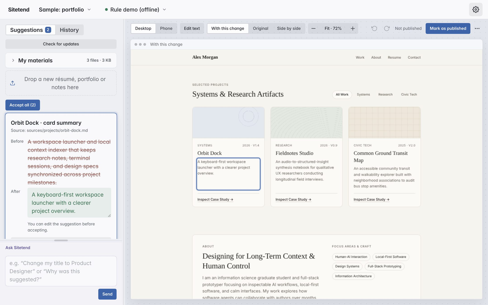
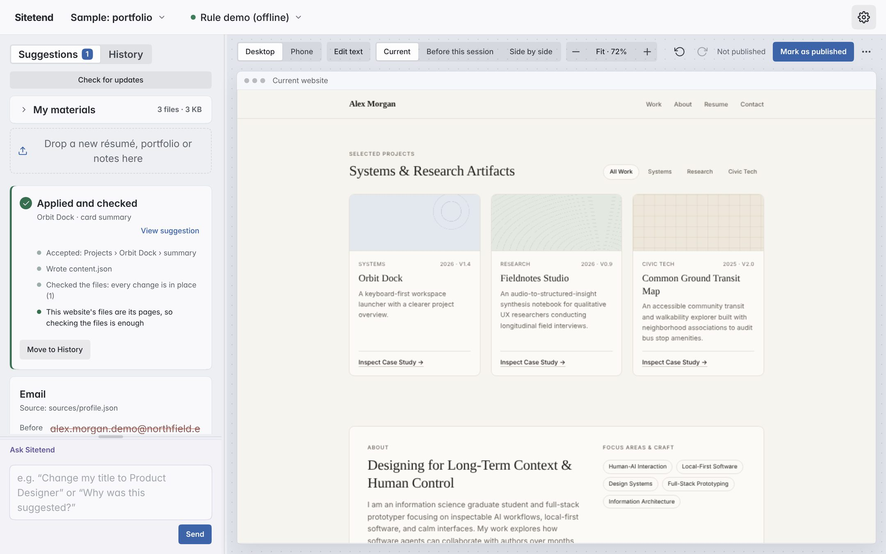
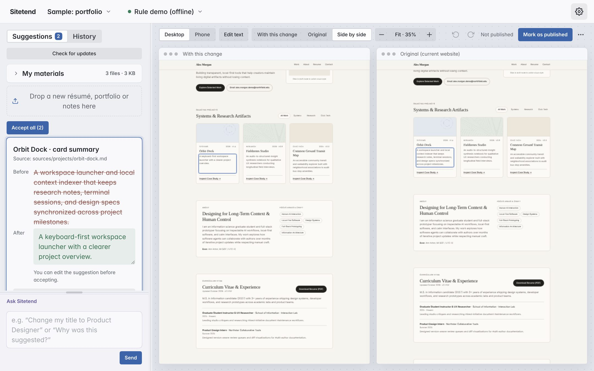
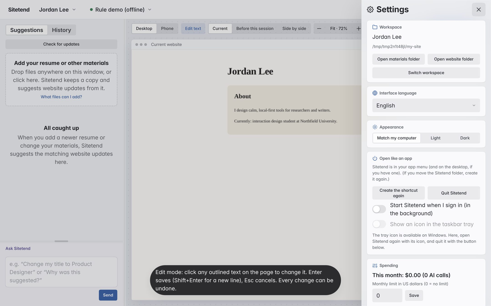

# Sitetend

**Keep your personal website up to date with your latest experience, without handing it over to an AI.**

Sitetend is a website-maintenance agent that runs on your own computer. When your materials change (résumé, project notes, bio), it finds what on your website should change too and proposes edits you can review. Each edit cites the line it came from, waits for your approval, and can be undone. You can also just tell it what to change, or fix wording right on the page.

**Who it's for:** people who made their website with an AI coding tool or by hand (Cursor, Claude Code, Lovable or Bolt exported to GitHub, a template they edited) and keep it as files on their computer, published through GitHub, Cloudflare Pages, Netlify or Vercel. Sites that live inside an online builder are out of scope.


## What it does

- **Notices when your materials change.** Drop in a résumé, a portfolio or a note of what's new (PDF, Word, Markdown, text, JSON), or type the change in the chat.
- **Shows its evidence.** Every suggestion quotes the exact line of your material it is based on. A second model reviews each one before you see it.
- **You decide.** Accept, edit the wording first, or reject. Nothing touches the site until you accept.
- **Checks its own work.** After you accept, it confirms the new words are really in the files and, for built sites, on the built page.
- **Undo anything.** Step back through your changes, or revert any single change in the history, even one made outside Sitetend.
- **Adds new entries.** A new project, paper or talk joins an existing list in the same format as its neighbours, in data files and in hand-written HTML (cards, timelines, photo grids). You can pick a picture for it.
- **Writes small code changes when nothing else fits.** Ask in the chat ("add my new project to the Experience page"), and the model suggests a small change to that page's code, copying the markup the page already uses. You see it in the live preview before you accept, it cannot add scripts or files from other websites, and it can be undone.
- **Remembers what you tell it.** "From now on, write job titles in English" becomes a note you can see, edit and remove.
- **Publishes for you.** To Git, Cloudflare Pages or Netlify, or as a .zip to upload yourself.
- **Works with the sites people have.** Plain HTML, Jekyll, Hugo, Astro, React, Next.js, Vue, Svelte and projects made with Lovable, Bolt or v0. In code projects (React, Vue…) it edits only the words.
- **Stays on your computer.** Sitetend, your keys, history, backups and notes are all local. Only the text being checked (the material and the website's words) goes to the model you chose, and files that look like secrets are never sent.

It cannot change a site that lives only in an online builder (Wix, Squarespace, Notion), words kept in a database, or words inside images. See [Supported websites](#supported-websites).

<details>
<summary><b>More screenshots</b></summary>

| | |
|---|---|
|  |  |
|  |  |
|  |  |
|  | |

</details>

## Quick start

No coding needed. Three steps:

1. **Download.** On this page, click the green **Code** button → **Download ZIP**, then unzip it (right-click → *Extract All* on Windows; double-click on a Mac).
2. **Double-click the start file** in the unzipped folder:
   - Windows: `start-win.bat`
   - macOS: `start-mac.command` (the first time, right-click → *Open*, because it was downloaded from the internet)
   - Linux: run `bash start-linux.sh` in a terminal

   You don't need to install anything. Sitetend runs on Node.js (free): on macOS and Linux, if it is missing, the first start downloads a private copy into `~/.sitetend/node` (about 50 MB, checked against nodejs.org's published checksum, no admin password). On Windows the start file offers to install it with the built-in *winget* (answer Y and allow the Windows prompt). Only if that fails does it open the Node.js download page.
3. **Your browser opens Sitetend.** Pick a language at the top right, then click **Open my website…** to choose your own folder, or **See a sample website** to try it first. Two sample websites (a portfolio and an academic homepage) are always in the website menu at the top left. A short guide walks you through the screen the first time.

To use AI suggestions, choose a model in the menu at the top left and paste its key there (or keep *Rule demo (offline)* to try everything without a key).

**After the first time, open it like an app.** Click *Create a desktop icon* on the welcome page (or Settings → *Open like an app* → *Create a shortcut*). That puts a Sitetend icon on the desktop and in the Start menu (Windows), in Applications (macOS) or in the app menu (Linux). Double-clicking it opens the running Sitetend, or starts it in the background - no terminal window - and opens it. In the same place you can start Sitetend when you sign in, and on Windows show a tray icon (click to open, right-click to quit). Closing the browser tab does not stop Sitetend; *Quit Sitetend* in Settings (or the tray) does.

## Supported websites

**The rule:** if your website's words are in files in a folder on your computer, Sitetend can read and change them, however the site was made (by hand, with a template, or by an AI tool). If the website is one folder down (for example `my-portfolio/frontend/`), opening the outer folder finds it.

**What does not work (three cases):**
1. **The website is not on your computer.** It lives only on an online builder: Wix, Squarespace, WordPress.com, Notion, or Framer / Webflow sites edited online. Exported to files, they work.
2. **The words are in a database.** Self-hosted WordPress or Ghost, or pages that load their text from a database or CMS while running (for example blog posts kept in Supabase). The words written into the pages themselves still work.
3. **The words are not text.** Words drawn into images, PDFs, videos or a canvas.

<details>
<summary><b>Kinds of site tested so far</b></summary>

| Kind of site | Examples | What you see in the preview | Tested on |
|---|---|---|---|
| Plain HTML pages | a hand-written or AI-made `index.html` (including content kept in its own `<script>`), Start Bootstrap, vCard | the real page, updated right away | 6 open-source templates + 2 own sites |
| Text kept in a JSON file | `content.json` + `index.html` | the real page, updated right away | 3 own sites + 2 sample sites |
| Jekyll | GitHub Pages sites, Academic Pages, al-folio, minima, Chirpy | a list of the site's text; the real page after "Set up" if the site was already built on this computer | 6 open-source templates + 2 own sites |
| Hugo | PaperMod, hugo-coder, hugo-profile | a list of the site's text; the real page after "Set up" if the site was already built on this computer | 5 open-source templates + 2 own sites |
| Hexo | Hexo blogs and personal sites | a list of the site's text; the real page after "Set up" (the first time takes 1–3 minutes) | 1 open-source template + 1 own site |
| Eleventy (11ty) | Eleventy Base Blog, Markdown + Nunjucks sites | a list of the site's text; the real page after "Set up" (the first time takes 1–3 minutes) | 2 open-source templates + 1 own site |
| Quarto | Quarto academic and personal websites (`.qmd` pages, `_quarto.yml`) | a list of the site's text; the real page after "Set up" if the site was already rendered on this computer | 2 open-source templates |
| GitHub profile | the README.md of a `username/username` repository | the README drawn the way GitHub shows it, updated right away | 1 own profile |
| Pages made by a script | `build.py` writes `index.html` | the real page after "Set up" | automated tests |
| AI website builders | Lovable, bolt.new, v0, Replit (React client + server in one project) | a list of the site's text; the real page after "Set up" (the first time takes 1–3 minutes) | 3 open-source projects + 2 own sites |
| JavaScript frameworks | Astro, React, Next.js, Gatsby, Vite, Vue, Nuxt, Svelte / SvelteKit, Angular | a list of the site's text; the real page after "Set up" (the first time takes 1–3 minutes) | 7 open-source projects + 2 own sites; a real Astro site built on Windows |
| Small web servers | Flask / Django (Jinja templates + Python), PHP pages, Node / Express (EJS, Handlebars), Ruby on Rails (ERB), Twig | a list of the site's text (these pages need their server to run) | Flask and PHP: 1 open-source project + 1 own site. EJS, Handlebars, ERB, Twig: automated tests |
| Any other website project | MkDocs, Docusaurus, Zola, a custom layout | a list of the site's text | automated tests |

Kinds of site Sitetend knows by name get the best preview (the real page). In server templates (PHP, Jinja, EJS, ERB, Handlebars, Twig) a sentence with template code inside it, such as `Hello <?= $name ?>`, is left alone, so a change can never overwrite the code. Any other website project opens in a general mode: every file that can hold words is read (pages, Markdown, data files, front-end code, Python, PHP, server templates), dependencies and build output are skipped, and the preview is the list of the site's words. A folder that is mostly documents and photos, a folder that holds several websites (Sitetend then lists them), or a program with no web files is not opened as a website.

</details>

<details>
<summary><b>Limits: list items kept in code, size, encoding</b></summary>

One limit inside supported sites: in projects where a list is kept in code (for example the projects in `config.ts`), Sitetend can change existing items but cannot yet add a new one.

Size and encoding: Sitetend reads up to 1,000 pages per site and up to 2 MB of text per page (pictures written into a page do not count). Pages must be saved as UTF-8; a page in an older encoding (GBK, Big5, Shift-JIS, Latin-1) is left untouched so its characters are not damaged. Sitetend names any page it cannot read, so nothing is skipped silently. Materials in those older encodings are read correctly. Backups: the 30 most recent full copies of the site's text are kept in the site's `.sitetend` folder; undo goes back up to 100 steps.

</details>

## Models

Choose a model in the menu at the top left: the free offline rule demo, Ollama on your computer, or Claude, OpenAI, Gemini or any OpenAI-compatible service with your own key. A monthly spending limit stops paid calls. Keys are saved in `~/.sitetend/.env`; they never reach the browser or the website folder.

<details>
<summary><b>Models, prices and the spending limit</b></summary>

The model menu at the top left switches between:

| Model | Price per million tokens (sent / received) | Key |
|---|---|---|
| Rule demo (offline) | free, no network; it only understands clearly marked fields | none |
| Claude Sonnet 5.5 · Claude Haiku 5.5 (low cost) | $2 / $10 · $0.10 / $0.50 | Anthropic |
| OpenAI GPT-6.1 Terra · GPT-6 Luna (low cost) | $1 / $5 · $0.10 / $0.50 | OpenAI |
| Gemini 3.8 Flash · Gemini 3.1 Flash-Lite (low cost) | $0.75 / $3.75 ($1.50 / $7.50 from 2027-01-01) · $0.25 / $1.50 | Google AI Studio |
| Ollama | free, runs on your computer | none |

Prices as published on 2026-11-16; they change, so you can correct them in Settings → Spending. The menu shows a *Get a key* link for the model you pick.

**Spending limit.** Settings → Spending shows this month's estimated cost (from the token counts each reply reports and the model's price) and takes a monthly limit. At 80% you get a reminder; at 100% Sitetend stops sending anything to paid models until next month (the rule demo and local models keep working). Your provider's bill is what counts.

Any OpenAI-compatible service (OpenRouter, DeepSeek, Azure, a company gateway, LM Studio…) can be added from the same menu with *Add a model…*. Keys are saved in `~/.sitetend/.env`; they never reach the browser or the website folder.

</details>

## Publishing

Choose where Publish sends your site under Settings → Publishing, or from the ⋯ menu next to Publish:

- **Git:** commit the website files and push. Covers GitHub Pages, and Vercel, Netlify or Cloudflare Pages sites connected to a GitHub repository (they rebuild on every push). Your materials and Sitetend's records are never included.
- **Cloudflare Pages:** upload the website straight to your Pages project, the same as dragging it into the Cloudflare dashboard. Set up once with an API token (a custom token with the permission *Account → Cloudflare Pages → Edit*; the setup window links to Cloudflare's page with it already chosen), your account ID and the project name. Leave *Branch* empty to update the live site, or name a branch for a preview.
- **Netlify:** upload the website straight to your Netlify site, the same as Netlify Drop or the Netlify CLI. Set up once with a personal access token and the site address (`mysite.netlify.app`, your own domain, or the Project ID). Tick *Upload as a preview only* to get a separate preview address.
- **Manual:** you upload the site yourself, and Sitetend remembers which version is live. *Download website (.zip)* in the same menu gives you a zip with the files at the top level, ready to drag into a host's upload page. This is also the way for traditional web hosting (FTP, cPanel).

For Cloudflare and Netlify, only files that changed are sent, *Test connection* checks the settings before anything is uploaded, and tokens are stored in `~/.sitetend/.env` only. A site with a build step uploads its build output (for example `dist/`), and only after a successful build. Sites that use Cloudflare or Netlify Functions are left to Git or the host's own tools, so a deploy never takes them off the site.

Nothing private is ever uploaded or zipped: `.sitetend/` (your materials and history), `.env` files, `.git/`, `node_modules/` and system files are left out.

## Memory

Sitetend keeps short notes about how you want your website written, so you do not have to repeat yourself. Nothing is saved behind your back, and every note is listed under Settings → Advanced → Memory.

<details>
<summary><b>How memory works</b></summary>

- **Preferences** are about wording and format ("months in full", "keep the bio under two sentences"). They apply to all your websites unless you set one to *Only this website*.
- **Decisions** are about what one website shows ("do not list my phone number"). They belong to that website.

Notes come from three places, and none is saved behind your back: you say it in the conversation ("remember…", "from now on…") or add it in Settings; you choose a reason after rejecting a suggestion; or you make the same small change to two suggestions and answer *Remember* when Sitetend asks.

When a model checks your materials, it is given the notes that fit (at most 20), after its usual instructions. Notes shape wording; they never create a change on their own, and a fact newly stated in your materials always wins over an older note. With no notes, the model receives exactly what it received before this feature existed. Notes are stored on your computer (`.sitetend/memory.json` in the website folder, `~/.sitetend/memory.json` for all websites) with a log of every change; they are never published and coding agents cannot read them.

</details>

## Safety

- **Backups.** Every day, before the first change, the whole website folder is saved as one `.zip` in `~/.sitetend/backups/`. The last 14 days are kept; Settings → Advanced → Backups restores one in a click.
- **No half-written files.** If Sitetend is closed in the middle of saving, the change is finished the next time the site is opened.
- **Nothing private is published.** Your materials, history, notes and `.env` files never leave your computer when you publish.
- **Code changes are checked.** A code change suggested in the chat must match the page exactly, may not add scripts, event handlers, frames, forms or files from other websites, and is shown in the live preview before you accept it.
- **Coding agents are limited.** Over MCP they can read the site and suggest; accepting needs your permission and publishing always needs you.

<details>
<summary><b>Backups, interrupted saves and the preview in detail</b></summary>

**Backups.** Every day, before the first change (and when you open the site), Sitetend saves the whole website folder as one `.zip` in your user folder (`~/.sitetend/backups/`), never inside the website. Unzip it and you have the site. The last 14 days are kept. Settings → Advanced → Backups lists them and restores one in a click; the current site is backed up first, and the restore is recorded in History and can be taken back. Tool folders (`node_modules`, `.git`) are not included.

**If Sitetend is closed in the middle of saving** (power loss, a forced quit), files are never left half-written, and the next time the site is opened the changes you had accepted are finished as one undoable step.

**Preview.** Sites with several pages: the preview follows the page of the selected suggestion, links in the preview move between pages, and a page picker shows any page. The normal preview does not run the site's own scripts (for safety) and lets you edit words in place. A page that is drawn by its own scripts (a video intro, a canvas, a single-page app) switches to a **live preview**: the real page with its scripts running, in a sandbox that cannot reach Sitetend. A selected suggestion is put in place there before you accept it, nothing is saved, and the changed words are highlighted. A page that another page loads with its scripts (for example `p/about.html`, loaded by `index.html` when its menu is clicked) is shown inside that page, since on its own it lacks that page's styles and paths. **Open in browser** shows the same in a separate tab.

</details>

## More

<details>
<summary><b>Languages</b></summary>

The interface opens in **English**. It is also available in **Simplified Chinese**, **Traditional Chinese** and **Spanish**: pick one on the welcome page (top right) or in Settings. The AI's explanations follow the interface language; suggested website text stays in the website's own language.

To add a language, copy `ui/locales/en.json` to `ui/locales/<code>.json` (for example `ja.json`), translate the values (an AI model does this well; keep the `{placeholders}`), and add one line to `ui/locales/languages.json`. Anything left untranslated falls back to English.

</details>

<details>
<summary><b>Updates</b></summary>

Once a day at most, Sitetend asks GitHub for the number of the latest release (nothing else is sent) and shows a quiet note when there is a newer one. Turn it off in Settings → Updates. To update, download the new version and replace the Sitetend folder; your websites, materials and settings are kept in a separate folder (`~/.sitetend`).

</details>

<details>
<summary><b>Sites generated by a script (build step)</b></summary>

If your pages are produced by a script, Sitetend detects the script (`build.py`, a `build` script in `package.json`, a `Makefile`, or Hugo/Jekyll output that was built locally) and offers to set it up as a **build step**:

- **Command:** for example `python build.py`.
- **Generated files:** for example `index.html`, or a whole folder such as `public/`.

From then on, suggestions go to the source files, the generated pages are never edited directly, and the build runs after every change, undo and revert. The preview shows the built page with each piece of source text mapped back to its field, so you can still edit in place.

The command is stored in your own Sitetend settings, not in the website folder. A site you download therefore cannot make Sitetend run anything, and MCP agents cannot change the command.

</details>

<details>
<summary><b>Materials from other apps (MCP sources)</b></summary>

If you keep notes, a bio or project write-ups in another app that has an MCP server, Sitetend can read them: model menu → *External sources (MCP)…* → *Add a source*. Give it the server's web address, or the command that starts it on your computer (for example `npx -y …`), plus a key if it needs one. *Connect* lists what the server offers; tick the documents (and, if you want, tools) to read.

What it reads is saved under `sources/external/<source>/` and analysed like any other material, so evidence, privacy rules and history work the same. Sources are read when you click *Check for updates*, or every 15 minutes / hour / 6 hours. Keys go to `~/.sitetend/.env`; addresses and commands are saved only in your own settings, never in the website folder, and agents connected over MCP cannot add or change them.

</details>

<details>
<summary><b>Webhooks</b></summary>

Model menu → *Events & webhooks…* sends a short signed message (Slack- and Discord-compatible) when something happens: new suggestions, a change written or undone, a publish, an edit made outside Sitetend, a failed build, external sources updated or failing, the model unreachable. Messages say what happened and how many - never the content of your materials or site. Each request carries `X-Sitetend-Signature: sha256=<HMAC of the body with the hook's key>`.

The same dialog can let a script on your computer start a check (after exporting a resume, from a git hook, from a scheduled task):

```bash
curl -X POST http://127.0.0.1:54321/hooks/check -H "Authorization: Bearer <key shown in the dialog>"
```

</details>

<details>
<summary><b>Let a coding agent use Sitetend (MCP)</b></summary>

Model menu (top left) → *Let other agents use Sitetend (MCP)* → turn on *Allow coding agents to connect* → *Copy Claude Code command*, for example:

```bash
claude mcp add sitetend -- node /path/to/sitetend/bin/sitetend.mjs mcp
```

By default, agents can only read the site and propose suggestions. Accepting and undoing must be enabled separately. Publishing always requires you.

</details>

## Evaluation

Judgement quality was measured with one OpenAI-compatible model (gpt-5.6-terra), using `node tools/eval.mjs`. Every test set was written before the model was run on it, and none was used to tune the rules.

**Final check, every set at once** ([eval/REPORT-final.md](eval/REPORT-final.md)): all 11 sets (291 cases on more than 50 websites), twice, reviewer on.

| | Result |
|---|---|
| Cases passed | 289 / 291 and 287 / 291 (99.0% ± 0.5) |
| Suggestions that were right | 98.4% (306 of the 311 that could be judged) |
| Needed changes that were suggested | 99.4% |
| "Leave it alone" cases that got a wrong card | 0.4% (1 of 266) |
| Tokens and time per case | about 11,000 tokens, 3.4 s (6.5 s at the 95th percentile) |
| Cost of one full run | about $7 (at $2 / $12 per million tokens sent / received) |

The misses are listed in the report.

<details>
<summary><b>Earlier runs, by set</b></summary>

- **Multi-site set:** 85 / 85 scenarios passed, across 18 websites (10 of them real open-source Jekyll, Hugo and Start Bootstrap templates). The scenarios check that it changes what should change, leaves alone what should not, and respects locked fields.
- **More open-source sites:** 28 / 28 on 7 more templates (HTML, Hugo, Jekyll), twice.
- **Framework sites:** 20 / 20 on Astro, React, Next.js, Vue and Svelte sites, twice.
- **Hexo and Eleventy sites:** 20 / 20 on 5 sites (3 open-source templates), twice.
- **Quarto, Gatsby, Nuxt and GitHub profile READMEs:** 20 / 20 on 5 sites (4 open-source templates), twice.
- **Sites made by AI builders (Lovable, bolt.new, v0, Replit), Angular, SvelteKit, Flask and PHP:** 30 / 30 and 29 / 30 on 10 sites (6 open-source projects), then 28 / 30 in each of 4 later runs, then 30 / 30 twice in the final check. The 4 runs at 28 / 30 missed the same two cases: a hobby in a Flask site's data file (Drawing → Pottery), and new open-studio hours in a v0 page that start next month. Both passed in the final check, so they are not fixed failures. Recorded, not tuned.
- **Harder cases:** 16 / 17 (several changes at once, PDF and Word resumes, the same facts reworded, contradictions, injected instructions). The miss: two different affiliations in one file were not flagged.
- **New entries:** 25 / 25 passed, in two separate runs.
- **Reviewer:** caught 219 of 221 planted mistakes and rejected 0 of 74 correct suggestions.
- **Repeat runs** ([eval/REPORT.md](eval/REPORT.md)): the last three sets, 3 runs with the reviewer on and 1 with it off. 97.1% every run (spread 0), 111 / 111 cards right, 0 of 90 false alarms. With the reviewer off the results were the same, using about 10% fewer tokens and 1 second less per case; the reviewer earns its cost on harder input, as the planted-mistake test shows.

</details>

<details>
<summary><b>What these tests do not show</b></summary>

- **The materials are cleaner than real ones.** Every case was written for testing: short, in English, one or two changes at a time. Real resumes and notes are longer and messier.
- **One author wrote every case.** Later sets were written after seeing earlier failures, so they may avoid known weak spots. A set written by someone else would be a stronger test.
- **Few runs.** The full suite ran twice, and each set has 13 to 85 cases, so a single set's score can move by several points between runs.
- **One model.** Only gpt-5.6-terra was measured. Other models work with Sitetend but have no numbers.
- **Judgement, not the whole flow.** The evaluation checks the suggestions. Writing the files, rebuilding the site and checking the new page are covered by the automated tests with a stand-in build, not by real framework builds.
- **One change at a time.** Months of use (edits on top of edits, undo, a growing pile of materials) were not simulated.
- **No real users yet.**

</details>

<details>
<summary><b>Known issue and how to run the evaluation</b></summary>

Known issue, left for a later version: the date rule ("a start date after today has not begun") also holds back announced changes that should go on the site with their date, such as new opening hours "from December".

A low-cost check with Claude Haiku (about $1 for the whole suite twice, with your own Anthropic API key saved in Sitetend): `eval/windows/run-claude-check.bat`, which writes `eval/REPORT-haiku.md`.

For the report: `eval/windows/run-eval-report.bat` or `eval/windows/run-final-two.bat` (or `node tools/eval.mjs --model <id> [--set <set>] --json [--max-dollars N]`, several times, then `node tools/eval-report.mjs`) writes a report with the pass rate of every run and its spread, which cases pass only sometimes, card precision, recall, false alarms, tokens and seconds per case, and the cost of each run. `--max-dollars` stops a run once it has cost that much.

The latest report: [eval/REPORT-final.md](eval/REPORT-final.md).

</details>

## Development

<details>
<summary><b>Commands and code layout</b></summary>

```bash
npm test          # about 370 checks: core engine, site adapters, host API, backups, publishing, memory, MCP, webhooks, chat, UI scripts
npm run eval      # judgement evaluation (rule mode by default; see tools/eval.mjs for real models)
```

| Path | What |
|---|---|
| `bin/sitetend.mjs` | Entry point (`mcp` subcommand starts the MCP server) |
| `src/host/` | Local host: HTTP API, write queue, file watching, chat agent, build step, backups, publishing (Git, Cloudflare Pages, Netlify), memory, user settings |
| `src/core/engine.js` | Versions, field-level three-way merge, per-operation undo, absorbing outside edits, reverting single changes |
| `src/agent/analysis-engine.js` | Material analysis, evidence checks, suggestions, reviewer, privacy filter |
| `src/adapters/` | Site adapters (JSON sites; text-file sites: HTML, static-site generators, framework projects, server templates), lists and new entries, model providers, file system |
| `src/mcp/stdio-bridge.mjs` | MCP server (forwards to the host) |
| `ui/` | Interface: plain JavaScript, no framework; light/dark themes; English, Simplified Chinese, Traditional Chinese, Spanish. Font: [Inter](https://github.com/rsms/inter) (SIL Open Font License 1.1, licence in `ui/fonts/OFL.txt`); Chinese text uses the computer's own font |
| `docs/images/` | Screenshots used in this README |

Workspace data lives in the site's `.sitetend/` folder, which is added to `.gitignore` automatically. User data lives in `~/.sitetend/`.

</details>

MIT License (the bundled Inter font is under the SIL Open Font License 1.1). The demo sites and people in them are fictional.
